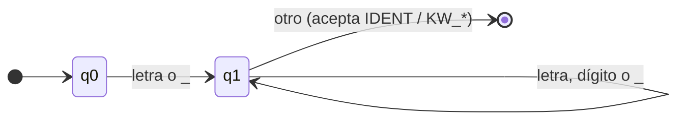
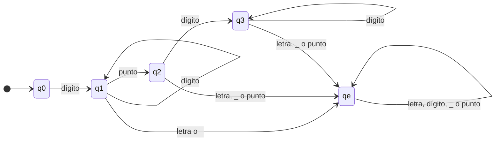
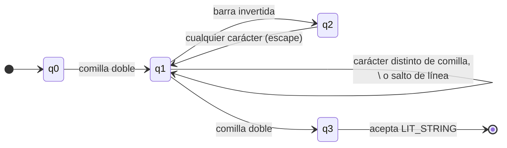
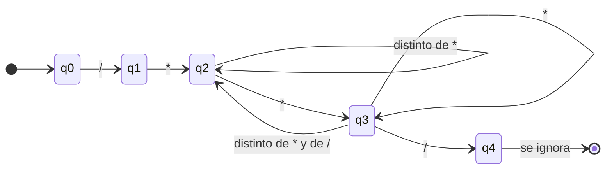

# Fase 1 — Análisis léxico (sección de Dev 1 para el informe)

## 1. Objetivo

La fase léxica lee `entrada.c` carácter por carácter y lo divide en **tokens**:
la unidad mínima con significado (palabra reservada, identificador, literal,
operador o delimitador). Para cada token registra su **tipo**, **lexema**,
**línea** y **columna**, y escribe la tabla en `tokens.txt`. Ignora los espacios
y los comentarios, y detecta los **errores léxicos** sin detenerse.

Herramienta: **Flex** (`lexer.l`). A partir de las expresiones regulares, Flex
construye un **autómata finito determinista (AFD)** que reconoce todos los
tokens a la vez.

## 2. Fundamento teórico: los tokens son lenguajes regulares

Cada categoría de token es un **lenguaje regular**: se describe con una expresión
regular y, por lo tanto (teorema de Kleene), existe un AFD que lo reconoce. La unión
de lenguajes regulares también es regular, así que un solo AFD reconoce todos los
tokens. Flex aplica estas construcciones: expresión regular → AFN de Thompson →
AFD por subconjuntos → minimización.

Flex resuelve las ambigüedades con dos reglas:
1. **Coincidencia más larga (maximal munch):** `+=` gana sobre `+` e `intx` es un identificador, no `int` + `x`.
2. **Prioridad por orden:** si dos reglas reconocen el mismo lexema, gana la que aparece primero. Por eso
   las palabras reservadas van **antes** que la regla de identificador: `int` es `KW_INT` y no `IDENT`.

**Límite del modelo:** un AFD no tiene memoria ilimitada, así que no puede verificar que los
paréntesis o las llaves estén balanceados: el lenguaje $\{(^n)^n \mid n \ge 0\}$ no es regular (lema del
bombeo, sección de Dev 4). Por eso la fase léxica solo clasifica `(` y `)` como tokens independientes,
y el anidamiento lo verifica la fase sintáctica con un autómata de pila.

## 3. Tabla de tokens y expresiones regulares

Definiciones auxiliares: `DIG = [0-9]`, `LET = [a-zA-Z_]`, `ARCH = [a-zA-Z0-9_/]+\.h`.

| Categoría | Token(s) | Expresión regular | Ejemplo |
|---|---|---|---|
| Palabras reservadas | `KW_INT`, `KW_FLOAT`, `KW_CHAR`, `KW_BOOL`, `KW_IF`, `KW_ELSE`, `KW_WHILE`, `KW_FOR`, `KW_SCANF`, `KW_PRINTF`, `KW_RETURN` | la palabra literal | `while` |
| Literal booleano | `LIT_BOOL` | `true \| false` | `true` |
| Identificador | `IDENT` | `LET (LET \| DIG)*` | `suma_1` |
| Entero | `LIT_INT` | `DIG+` | `10` |
| Decimal | `LIT_FLOAT` | `DIG+ \. DIG+` | `3.14` |
| Carácter | `LIT_CHAR` | `' ( [^'\\\n] \| \\. ) '` | `'a'`, `'\n'` |
| Cadena | `LIT_STRING` | `" ( [^"\\\n] \| \\. )* "` | `"Suma = %d\n"` |
| Include | `PP_INCLUDE` | `#[ \t]*include[ \t]*( <ARCH> \| "ARCH" )` | `#include <stdio.h>` |
| Aritméticos | `OP_PLUS OP_MINUS OP_MUL OP_DIV OP_MOD` | `+ - * / %` | `*` |
| Asignación | `OP_ASSIGN OP_ADD_ASSIGN OP_SUB_ASSIGN OP_MUL_ASSIGN OP_DIV_ASSIGN` | `= += -= *= /=` | `+=` |
| Relacionales | `OP_EQ OP_NE OP_LT OP_GT OP_LE OP_GE` | `== != < > <= >=` | `<=` |
| Lógicos | `OP_AND OP_OR OP_NOT` | `&& \|\| !` | `&&` |
| Dirección | `OP_AMP` | `&` (solo para `scanf`) | `&x` |
| Delimitadores | `DELIM_SEMI DELIM_COMMA DELIM_LPAREN DELIM_RPAREN DELIM_LBRACE DELIM_RBRACE` | `; , ( ) { }` | `{` |
| Se ignoran | — | `[ \t\r\f\v\n]+`, `//[^\n]*`, `/* ... */` | — |

## 4. Autómatas finitos de los tokens principales

### 4.1 Identificadores y palabras reservadas



El AFD acepta cualquier identificador. Al aceptar, Flex consulta el orden de las
reglas: si el lexema es una palabra reservada (`int`, `while`, ...), se emite el
token `KW_*` correspondiente; si no, `IDENT`.

### 4.2 Números (entero, decimal y número mal formado)



| Estado | Si el lexema termina aquí |
|---|---|
| `q1` | acepta `LIT_INT` (`10`) |
| `q3` | acepta `LIT_FLOAT` (`3.14`) |
| `q2` | error: número mal formado (`3.`) |
| `qe` | error: número mal formado (`9abc`, `1.2.3`, `3.14f`) |

### 4.3 Cadenas



Si llega un salto de línea o el fin de archivo estando en `q1`/`q2`, se reporta
«cadena sin cerrar». El literal `char` usa el mismo autómata con comilla simple y
exige exactamente un carácter (o un escape) entre las comillas.

### 4.4 Comentario multilínea



Expresión regular equivalente: `"/*"([^*]|\*+[^*/])*\*+"/"`. Si el archivo termina en `q2` o `q3`,
se reporta «comentario sin cerrar» en la posición donde empezó.

## 5. Línea y columna

Flex no cuenta columnas por sí solo. La macro `YY_USER_ACTION`, que se ejecuta antes de
cada regla, guarda la posición de inicio del token (`tok_line`, `tok_col`) y luego
avanza el cursor sobre el lexema con la función `avanzar()`:
- `\n` → línea + 1 y columna = 1;
- cualquier otro carácter → columna + 1 (un tabulador cuenta como 1 columna y un carácter UTF-8
  de varios bytes como 1, porque los bytes de continuación no se cuentan).

Como `avanzar()` recorre todo el lexema, también funciona con comentarios de varias líneas, que
era el caso problemático (ver `pruebas/dev1/columnas.c`: el `int` que sigue a un comentario
multilínea y a un tabulador queda en la columna 18 de la línea 3).

## 6. Formato de `tokens.txt` (ejemplo real)

Para `int main() {` seguido de `float y = 3.14;`:

```
# TIPO             LEXEMA             LÍNEA     COL
KW_INT             int                3         18
IDENT              main               3         23
DELIM_LPAREN       (                  3         27
DELIM_RPAREN       )                  3         28
DELIM_LBRACE       {                  3         30
KW_FLOAT           float              4         2
IDENT              y                  4         8
OP_ASSIGN          =                  4         10
LIT_FLOAT          3.14               4         12
DELIM_SEMI         ;                  4         16
```

## 7. Errores léxicos y recuperación

El lexer **reporta todos sus errores y sigue leyendo** (decisión A9). Cada error tiene su propia
regla, que consume el lexema erróneo completo para que un solo problema no genere errores en cascada.
Al final, una regla `.` atrapa cualquier carácter no reconocido.

| Error | Ejemplo | Mensaje | Recuperación |
|---|---|---|---|
| Carácter inválido | `@`, `\|`, `ñ` | `carácter inválido '@'` | se descarta el carácter |
| Número mal formado | `9abc`, `3.`, `1.2.3`, `.5` | `número mal formado '9abc'` | se descarta el lexema completo |
| Cadena sin cerrar | `"hola` | `cadena sin cerrar` | se descarta hasta el fin de línea |
| Char sin cerrar / vacío / largo | `'x`, `''`, `'ab'` | `literal char sin cerrar` / `vacío` / `con más de un carácter` | se descarta el lexema |
| Comentario sin cerrar | `/* ...` | `comentario sin cerrar` | se descarta hasta el fin de archivo |
| Directiva no soportada | `#define MAX 10` | `directiva no soportada '#define'` | se descarta la línea |
| `#include` mal formado | `#include <stdio>` | `#include mal formado: ...` | se descarta la línea |

Ejemplo real (`pruebas/dev1/lexico_todos.c`), `errores.txt`:

```
pruebas/dev1/lexico_todos.c:2:1: error[LEX]: directiva no soportada '#define' (solo se admite #include)
pruebas/dev1/lexico_todos.c:3:1: error[LEX]: #include mal formado: se esperaba <nombre.h> o "nombre.h"
pruebas/dev1/lexico_todos.c:5:13: error[LEX]: número mal formado '9abc'
pruebas/dev1/lexico_todos.c:6:15: error[LEX]: número mal formado '3.'
pruebas/dev1/lexico_todos.c:7:15: error[LEX]: número mal formado '1.2.3'
pruebas/dev1/lexico_todos.c:8:15: error[LEX]: carácter inválido '@'
pruebas/dev1/lexico_todos.c:9:14: error[LEX]: literal char vacío ''
pruebas/dev1/lexico_todos.c:10:14: error[LEX]: literal char con más de un carácter 'ab'
pruebas/dev1/lexico_todos.c:11:14: error[LEX]: literal char sin cerrar
pruebas/dev1/lexico_todos.c:12:12: error[LEX]: cadena sin cerrar
pruebas/dev1/lexico_todos.c:13:9: error[LEX]: carácter inválido 'ñ'
pruebas/dev1/lexico_todos.c:14:11: error[LEX]: carácter inválido '|'
pruebas/dev1/lexico_todos.c:17:1: error[LEX]: comentario sin cerrar
Fases sintáctica y semántica omitidas por errores léxicos
```

## 8. Integración con las demás fases

1. `main.c` ejecuta la **pasada léxica completa** (`lexer_ejecutar()`): todos los tokens quedan en una
   tabla y se escribe `tokens.txt`.
2. **Corte por fase:** si hubo errores léxicos, el parser no se ejecuta y `errores.txt` termina con
   «Fases sintáctica y semántica omitidas por errores léxicos» (código de salida 1).
3. Si no hubo errores, Bison pide los tokens con `yylex()`, que los entrega desde la tabla junto con su
   lexema (`yylval`) y su posición (`yylloc`). Así los errores sintácticos también llevan línea y columna exactas.
